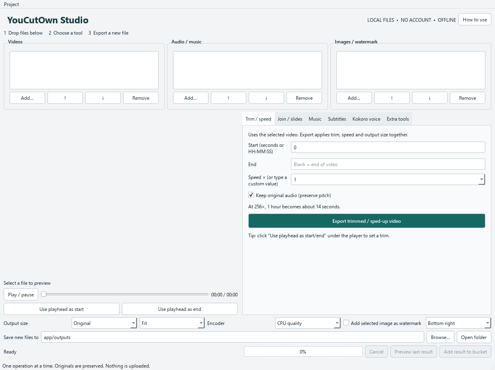

# YouCutOwn Studio

**Your media. Your machine. No subscription.**

Free, open-source video, audio, and image tools for Windows, powered by Python and
FFmpeg. Trim, speed up, join, subtitle, add music, watermark, and convert—all on
your own computer.

A native desktop workbench with three drag-and-drop buckets and simple action
buttons. Choose a task, export a new file, and carry on. No account, API key,
browser server, subscription, or paid rendering service is required.



## Download and run

1. Select **Code → Download ZIP**, or download the source ZIP from
   [Releases](https://github.com/cryptokali007/youcutown-studio/releases).
2. **Extract the entire ZIP** into a folder you can write to, such as a folder
   inside Documents. Do not run the BAT directly inside the ZIP.
3. Double-click **windows.bat**. On first run it performs the installation and
   then opens the desktop application.
4. Keep the whole folder together. Later launches use the same **windows.bat**.

The first setup needs internet to fetch the private Python runtime, pinned Python
packages, FFmpeg, Whisper models, and Kokoro voices. After setup, normal editing,
transcription, and voice generation work offline. Setup keeps downloads locally
for repair. Allow several gigabytes of disk space for the full installation,
download cache, and exports; long video jobs need additional temporary space.

You do not need to install Python, Git, Node.js, a CUDA toolkit, or FFmpeg globally.
A standard Microsoft Visual C++ x64 runtime may be needed by native dependencies.
If it is missing, setup downloads the pinned official redistributable and Windows
may ask you to approve installing it. It does not install GPU drivers or a CUDA toolkit.
[Microsoft's runtime installer](https://aka.ms/vc14/vc_redist.x64.exe) is also available for manual setup.

## What it does

| Task | Controls |
| --- | --- |
| Trim and change speed | Start/end times; pitch-preserving audio; presets through 256×; custom 0.0625×–4096× |
| Join clips | Mixed sizes/frame rates; missing audio; hard cuts or transitions |
| Add music | Replace or mix sound; loop a short video to a longer track |
| Subtitles | Local Whisper transcription; editable SRT; highlighted, outlined, or boxed captions |
| Watermark | Selected image in a chosen video corner |
| Kokoro narration | Generate local voice WAVs, then use them as audio tracks |
| Audio tools | Extract, join, and normalize audio |
| Images | PNG, quality-95 JPEG/JPG, lossless WebP; resize; slideshow; video-frame extraction |

Drop files into **Videos**, **Audio / music**, and **Images / watermark**. Select
a tool and export. Single-file tools use the selected row; join tools use bucket
order. Outputs are new files: source media is preserved. One operation runs at a
time. The built-in **How to use** button opens the [everyday guide](app/GUIDE.md).

## Requirements and limits

- Windows 10/11 **x64**. This release does not provide ARM64, macOS, or Linux setup.
- CPU editing and speech are supported. More RAM and free SSD space help larger jobs.
- Optional NVIDIA H.264 encoding needs a compatible GPU and working NVIDIA driver.
  Select CPU quality when hardware encoding is unavailable. The CUDA toolkit is
  not required for this application's NVENC export path.
- Exports use 30 FPS. Speed changes sample frames; there is no motion interpolation.
- This is a button-driven toolkit; it has no multitrack timeline or live recording.
- Codec/preview support varies. FFmpeg export may work when preview cannot decode
  a particular input. Image conversion flattens animated/multilayer inputs to one frame.
- JPEG is lossy and composites transparency onto white. Lossless WebP preserves
  ordinary 8-bit RGB/RGBA pixels; resizing or reducing bit depth changes pixels.

## Install, repair, or prepare an offline copy

Run these from the extracted project folder:

```bat
Install.bat -NoPause
Install.bat -CoreOnly -NoPause
Repair.bat -Offline -NoPause
```

The default install includes English `base.en`, multilingual `small`, and Kokoro
assets. **-CoreOnly** skips speech-model weights and keeps the editing tools;
rerun Install.bat without that flag to add speech later. Repair verifies managed
assets and reinstalls packages while preserving models, source media, and outputs.
Offline repair requires the cached downloads from a prior successful setup.

For another offline PC, complete setup first, close the app, and copy the entire
project folder—including **app/runtime**, **app/bin**, **app/models**, and
**app/cache**. A GitHub source ZIP alone does not contain those large downloads.

## Manual setup and development

Clone the repo or extract its ZIP. The BAT files are wrappers for transparent,
editable PowerShell and Python setup scripts:

```powershell
powershell.exe -NoProfile -ExecutionPolicy Bypass -File scripts/setup/setup.ps1 -NoPause
app/runtime/python.exe app/app.py
app/runtime/python.exe -m pip check
app/runtime/python.exe -m unittest discover -s tests -v
app/runtime/python.exe app/tests/verify_image_formats.py
app/runtime/python.exe app/tests/verify_media.py --core-only
app/runtime/python.exe app/tests/verify_recovery.py
```

To run full local speech tests after downloading models, omit **--core-only**.
Set **YCO_TEST_NVENC=1** only on hardware where you also want to test NVIDIA export.
Tests generate their own synthetic media. The full speech test blocks outbound
Python socket connections during actual Kokoro/Whisper inference.

Dependency versions and wheel hashes are in [app/requirements.lock](app/requirements.lock).
Runtime, FFmpeg, and model URLs and hashes are in
[scripts/setup/assets.json](scripts/setup/assets.json). They are pinned deliberately;
updates must be tested before changing the lock or asset manifest.

## Troubleshooting

- **Setup failed:** keep the terminal output; inspect `app/logs/setup.log`, then
  run Install.bat again. A blocked connection, incomplete download, missing native
  runtime, or unwritable folder can prevent setup.
- **Missing speech model:** run Install.bat without -CoreOnly while online.
- **NVIDIA export fails:** choose CPU quality, or check your GPU/driver support.
- **Not enough disk space:** choose another output folder and leave room for
  temporary video files. Keep your source files in place during a job.
- **Updating source:** close the app, replace source files with a newer release,
  and run Install.bat again. Keep generated app folders and personal media intact.

## About the project

Created from a practical local editing workflow: inexpensive hardware, useful
buttons, and no per-export service. Developed with AI assistance; architecture,
integration, and verification were directed and reviewed by the maintainer.
The portable installer layout was inspired by Tech Jarves's original
[Portable Local Studio](https://github.com/techjarves/Portable-Local-Studio).
The Python setup and application code in this project are maintained here.

See [CONTRIBUTING.md](CONTRIBUTING.md), [SECURITY.md](SECURITY.md),
[validation notes](docs/VALIDATION.md), and [third-party notices](THIRD_PARTY_NOTICES.md).

Licensed under **GPL-3.0-or-later**. Dependencies and model weights retain their
own licenses. This project is independent of the companies and upstream projects
whose tools it uses.
