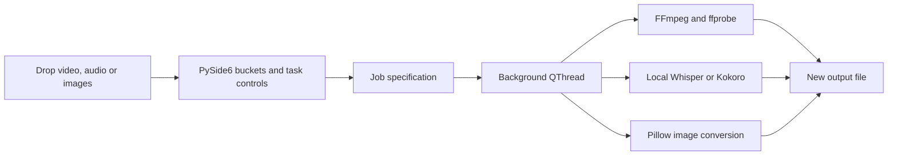

# How the workbench fits together

The app is a small native desktop interface around file-based processing jobs.
Python coordinates the tools; FFmpeg performs the video/audio work. There is no
HTTP server, browser framework, database, or cloud rendering backend.

## Read the source

- **app/app.py** sets offline environment flags, constructs the native application,
  and applies a readable light palette.
- **app/media_workbench/ui.py** contains the drag/drop lists, previews, task buttons,
  worker thread, progress/error handling, and project/settings serialization.
- **app/media_workbench/engine.py** probes media, builds FFmpeg argument lists,
  normalizes clips for transitions, retimes video/audio, runs local speech models,
  and exports images. It passes filenames as arguments without a shell.
- **app/media_workbench/captions.py** parses SRT and creates ASS subtitle styles
  for FFmpeg/libass, including word-level highlights.
- **scripts/setup/** downloads and verifies the private runtime/dependencies.
  The setup scripts are the explicit network boundary.

## Add a tool

1. Add task controls and an action button in ui.py.
2. Include the required values in build_spec(). Keep task inputs explicit.
3. Dispatch the operation in Job.export() and implement its processing method.
4. Keep originals unchanged, use unique output names, check cancellation, and clean
   only temporary files owned by that job.
5. Validate the produced file, then return its path and probed metadata to the UI.
6. Add a small synthetic end-to-end case and verify actual media output.

The GUI stays responsive while a job runs, but accepts only one operation at a
time. Temporary normalized clips live under app/work/<job-id>; outputs have unique
names. The video encoder can be CPU or explicitly selected NVIDIA H.264. Speech
transcription uses CPU int8, keeping the optional GPU requirement out of core use.

## Packaging

windows.bat checks required managed files and calls Install.bat when needed.
PowerShell bootstraps the private Python ZIP and pip wheel; Python then installs
the hash-locked wheel set, verifies/extracts FFmpeg, and prepares speech assets.
No existing maintainer cache or system Python installation is used.

Source ZIPs contain source and setup metadata. Downloaded tools and models remain
inside app/ but outside Git, so a completed installation can be copied as a folder
for offline use. Test core-only setup on Windows CI; run full speech and optional
NVIDIA checks on suitable local hardware before a release.
